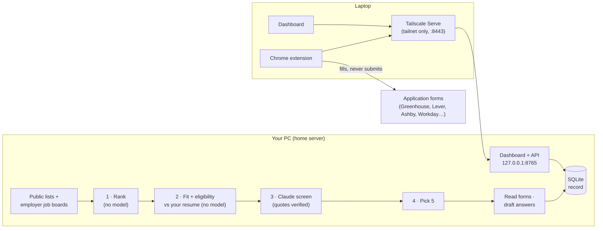

# JobApps

**A self-hosted assistant for internship season.** Every morning a small server on your own PC
collects fresh internship postings, picks the **5 you have a real chance at** given your resume,
reads their application forms, and drafts the written answers with Claude, with every fact checked
against your resume. You work through them from a dashboard on your laptop, and a Chrome extension
fills each application form for you: text fields, dropdowns, Workday's multi-page wizard, uploads.

You review every page and press **Submit** yourself. JobApps never submits anything.

- **Fits you, not just keywords.** Postings are ruled out when you can't get them (graduate-only,
  years of experience, graduation window, citizenship/clearance, sponsorship) and scored on how
  well your resume covers what they ask for.
- **Grounded.** Model output only counts when it quotes the posting and your resume word for word;
  drafted answers list the resume facts they use, and anything unverified is flagged.
- **Deterministic.** Same postings + same files + same day = the same picks and the same field values.
- **Private.** Runs on your machine, reachable only from your own devices over Tailscale. Your
  profile, resume, answers and history never leave it (except the text sent to Claude to draft and screen).

> Out of the box it's tuned for **Canadian software / AI internships** (Toronto first, Summer 2027).
> Everything about what it looks for lives in `config.yaml`.

## Contents

- [What it does](#what-it-does)
- [How it works](#how-it-works)
- [Requirements](#requirements)
- [Installation](#installation)
- [Configuration](#configuration)
- [Using it](#using-it)
- [Command line](#command-line)
- [Supported sites](#supported-sites)
- [Data and privacy](#data-and-privacy)
- [Security](#security)
- [Project layout](#project-layout)
- [Development](#development)
- [Troubleshooting](#troubleshooting)
- [Limits and responsible use](#limits-and-responsible-use)

## What it does

**Every morning (07:30)**
- Pulls postings from public internship lists and ~140 employers' own job boards, merges duplicates,
  and keeps a permanent record of every posting it has ever seen.
- Picks **5 new jobs** that fit your resume. Nothing you've already had on a list (applied, skipped,
  swapped out) or that was ruled out comes back, nor the same role under another link or the same
  company under another name. Companies you've had in the last week are skipped when there are others.
- Reads each application form ahead of time (Greenhouse, Lever, Ashby) and drafts answers to the
  written questions from your resume and notes.
- Unfinished jobs stay on the list, shown apart, for up to 3 days.

**On the dashboard** (Today · Postings · History · Setup)
- Today's 5, each with **why it fits** (skills you have and lack, every requirement checked against a
  quote from your resume), the drafted answers to edit in place, and an **Open application** button.
- **Ask Claude to change an answer** ("lead with my internship, not the hackathon project"), and tick
  *Remember this* to make it a standing instruction for every future draft.
- **Add 1 / 3 / 5 more** on a good day, or put any posting on today's list from **Postings**.
- Your full **record**: every posting ever collected and what happened to it, searchable, with CSV
  export; every past application with its link, a saved copy of the posting, your answers and a
  timeline; time spent per application with averages by site.

**In the browser (Chrome extension)**
- Fills the form when you open one of today's applications; on any other application page it offers
  **Fill this page** (or press ⌥J / Alt+J).
- Handles text fields, dropdowns (including React and Workday-style ones), search-as-you-type boxes,
  radio/checkbox groups, split date boxes, file uploads, and Workday's whole wizard: it presses
  **Add** for each job, school and link, and replaces whatever Workday guessed from your resume.
- **Answer once, filled forever**: when it can't fill something, you answer it on the page (or in
  Setup) and it's remembered for every future form that asks the same question.
- Times how long you actually spend on each application, and marks the job applied when you submit.

## How it works



### Picking the day's jobs

1. **Rank** (no model): fresh postings, forms it can read, preferred locations and role types first.
   The top 50 are checked live (closed postings are dropped).
2. **Fit and eligibility** (no model): each posting is read and ruled out if it's graduate-only, asks
   for more years than you have, has a graduation window or "returning to school" date that excludes
   you, needs a citizenship or clearance you don't have, won't sponsor when you need it, or has a GPA
   floor above yours. Every rule-out shows the posting's own sentence. Skill overlap with your resume
   is scored.
3. **Claude screen** (top 15): Claude lists the posting's key requirements. The server accepts a
   requirement only if it appears **word for word in the posting**, and counts it as met only if
   Claude quoted **your resume** word for word. Everything else is dropped or downgraded, and the
   score is computed from what survived. Results are cached, so each posting is judged once.
4. **Pick 5**: best total score, one per company, at most one stretch role and at most one job outside
   Canada per day (both configurable), skipping repeats and recently seen companies.

### Drafting answers

The drafting prompt is built from what screening systems actually do with written answers: applicant
tracking systems auto-reject on structured "knockout" questions (work authorization, sponsorship,
location), which JobApps fills from your profile and never drafts; written answers are skimmed by a
person, so they need to be specific, provable and not sound generic.

- Each answer is planned by question type (why this company, why this role, project, behavioural,
  fit, career goals…) and quotes the **posting lines it answers**; those quotes are checked against
  the posting.
- Every fact about you must come from your resume or notes (`facts_used`, checked word for word);
  invented facts or numbers are flagged on the dashboard.
- Stock phrasing recruiters skip ("passionate", "leverage", "not only… but also") is detected.
- One automatic rewrite fixes answers that break a checkable rule (length limit, unsupported fact,
  unsourced company claim, stock phrasing); the rewrite is kept only if it's better.
- Prompts are saved and shown on the dashboard, so you can see exactly what was asked.

### Filling forms

The extension finds every field and its question (label, legend, nearby text), sends them to your
server, and the server decides each value; the extension only types and clicks. Values come from,
in order: a numbered block it belongs to (Work Experience 2, Education 1) → your `custom_answers`
rules → answers it has learned from you → built-in rules → a drafted answer → you. Sponsorship,
work-authorization and consent questions always come from your profile (or you), never from memory.

## Requirements

**Server (any always-on PC; the installer is for Windows)**
- Python 3.11+
- [Tailscale](https://tailscale.com) on the PC and on your laptop
- Claude, either the [Claude Code CLI](https://docs.anthropic.com/en/docs/claude-code) signed in
  with your account (`claude`), or an `ANTHROPIC_API_KEY`. Without either it still picks jobs and
  fills forms; it just writes the prompts instead of drafting.

**Laptop**
- Chrome, Arc, Brave or Edge (Chromium-based; Safari isn't supported), on the same tailnet

## Installation

### 1. The server

```powershell
git clone https://github.com/pyturtle/jobapps; cd jobapps
python -m venv .venv
.venv\Scripts\pip install -e .[dev]
.venv\Scripts\python -m playwright install chromium
powershell -ExecutionPolicy Bypass -File scripts\install-server.ps1
```

`install-server.ps1` registers a **JobApps Server** scheduled task that starts the server when you
sign in, with a 5-minute watchdog that relaunches it if it ever stops, and publishes the dashboard to
your tailnet with `tailscale serve` on port 8443 (tailnet only, never public). It prints the address
to open. Run it again with `-Remove` to undo everything.

Without the script: `.\ja serve` (or `python -m jobapps serve`) and open http://127.0.0.1:8765.

On first run your personal files are created from templates: `profile.yaml` (from
`profile.example.yaml`) and `background.md` (from `background.example.md`). They, your resume,
`learned_answers.yaml` and everything in `data/` are git-ignored.

### 2. Your details

Open the dashboard → **Setup**:
1. Drop in your **resume PDF**. Picks, fit checks and answers all read from it.
2. Fill in the highlighted **details**: graduation date, citizenship, work authorization and
   sponsorship (these legal answers are never guessed).
3. Check **work history and skills** (typed into Workday's My Experience page and similar), and add
   **notes for answers**: projects, experience, short true stories, what you learned.
4. **Re-pick today's jobs** so today's list reflects your resume.

### 3. The extension

On a Mac, the easiest way keeps it updated by itself (Setup shows this command with a Copy button):

```bash
curl -fsSL https://<your-pc>.<your-tailnet>.ts.net:8443/mac-setup.sh | bash
```

It puts the extension in `~/JobApps/jobapps-extension` and adds a LaunchAgent that checks your server
every 15 minutes (a few bytes; it downloads only when there's a new build). Then in
`chrome://extensions`: switch on **Developer mode**, **Load unpacked**, pick that folder, and pin it.
New versions reload themselves; if one is waiting, the toolbar popup shows **Reload JobApps**.
Undo with `bash ~/JobApps/uninstall.sh`.

On other systems: download the zip from **Setup**, unzip it, and load the folder the same way
(download again to update).

## Configuration

### `config.yaml`: what to look for

| Key | What it does |
|---|---|
| `daily_count` | new jobs per day (5) |
| `carry_over`, `carry_days`, `carry_max` | keep unfinished jobs on the list, apart from the new picks, for N days |
| `company_cooldown_days` | skip companies you've had in the last N days when there are others |
| `max_per_company` | jobs from one company per day |
| `sources` | public lists to pull (JSON / markdown feeds) |
| `boards` | employers' own Greenhouse / Lever / Ashby / Workday / SmartRecruiters boards to poll |
| `filters` | age, categories, title include/exclude regexes, terms, degree, locations, companies |
| `scoring` | recency, readable forms, categories, terms, locations, title keywords, favourite companies |
| `fit` | how many postings are read and how skill overlap and experience limits count |
| `screen` | the Claude screen: how many, its weight, the minimum verified fit |
| `reach_companies`, `max_reach_per_day` | cap stretch roles per day |
| `max_outside_canada_per_day` | cap jobs outside Canada per day (`null` = no cap) |
| `discover` | optional Claude web search for postings the lists missed (off by default) |
| `server` | `daily_at`, `port`, `allowed_logins` (tailnet logins allowed in; empty = the PC's owner) |
| `drafts` | `backend` (`auto` / `api` / `claude-cli` / `none`), `model`, `effort`, `parallel`, `timeout_seconds` |

### Your files

| File | What's in it |
|---|---|
| `profile.yaml` | everything typed into forms: name, contact, address, links, education, work history, skills, legal answers, preferences, EEO choices (`decline` by default), `custom_answers` regex rules, `writing_preferences` for drafts. The dashboard edits it without losing comments. |
| `background.md` | free-form notes the drafter may use as facts: projects, experience, stories, things to always or never mention |
| `learned_answers.yaml` | answers you gave on forms, reused when the same question comes up (editable in Setup) |
| `resume.pdf` | your resume (uploaded in Setup) |

A **`custom_answers`** rule answers any question matching a regex before anything else:

```yaml
custom_answers:
  - match: "how many hours (per|a) week"
    answer: "40"
  - match: "security clearance"
    answer: null        # always leave it for me
```

## Using it

**Today.** The day's 5 (plus any extras you add), then *Still open from earlier days*. Open a job
to read why it fits, edit its drafted answers, see what will be filled in and the prompt used, then
**Open application**. The tally shows your progress, and **‹ previous day** opens earlier lists.

**Postings.** Every posting ever collected, with what happened to it: never picked, on your list,
applied, skipped, ruled out (with the reason) or swapped out by a re-pick. Search, filter (status,
Canada, still open), **Download CSV**, and **Add to today**.

**History.** Average, median and total time per application and by site; each day's list; and every
application you've finished, with a **Record** of its links, the saved posting, your answers and a
timeline.

**Setup.** Resume, details, work history and skills, questions waiting for an answer, everything
remembered, notes for answers, writing preferences, the extension, and a **System** panel showing
the server, the daily run, feeds, Claude and backups.

**On an application page** the extension panel shows what it filled (green), drafted (blue) and what
needs you (red). Fill in a red one and it's remembered for next time. Press the site's own Submit
button; the job is marked applied when the confirmation page shows, or press **I submitted it**.

## Command line

Run from the project folder (`.\ja` on Windows, or `python -m jobapps`):

| Command | What it does |
|---|---|
| `ja serve` | the dashboard and the daily scheduler |
| `ja today [--more N] [--refresh]` | build (or show) today's list, draft answers, write the HTML report |
| `ja status` | today's list, backlog and totals |
| `ja explain N` | every point and quote behind pick N, and how each of its fields will be filled |
| `ja apply [N]` | fill today's jobs in a browser on this PC, one by one |
| `ja done N` / `ja skip N` | mark job N applied / drop it |
| `ja redraft N` | throw away job N's drafted answers and draft again |
| `ja skills` | what the fit check reads from your resume |
| `ja fetch` | refresh listings now |
| `ja report` | rebuild and open today's HTML report |
| `ja history` | recent applications |
| `ja doctor` | check your setup |

## Supported sites

| | Read ahead (questions + description) | Filled by the extension |
|---|---|---|
| Greenhouse, Lever, Ashby | yes | yes |
| Workday | description | yes, including the multi-page wizard |
| SmartRecruiters, Workable, iCIMS, Taleo, SuccessFactors, Oracle Cloud, Jobvite, BambooHR, Rippling, Dayforce, UKG, Paylocity, ADP, Eightfold, Phenom, Avature… (50+ domains) | — | yes (generic forms) |

Any other site: open the toolbar popup → **Fill this page**.

Sources pulled every morning (chosen after comparing about 40 candidate lists): SimplifyJobs
Summer 2027, vanshb03 Summer 2027, Francklin9999 canada-internship, dreamworkhq
Open-Tech-Internships (Canadian slice), speedyapply SWE + AI (international), and the employer boards
in `config.yaml`. The same posting from several sources becomes one entry.

## Data and privacy

- Everything lives in the project folder on your PC: `data/jobapps.db` (SQLite: postings, lists,
  statuses, answers, the event log and timer), `data/jobapps.log`, daily backups in `data/backups`
  (last 7), saved prompts in `data/prompts`, plus your personal files above. None of it is tracked
  by git.
- Sent to Claude: the posting text, your resume and notes, and the profile basics answers draw on
  (name, school, degree, graduation, work authorization), to screen and draft. Nothing else, no
  telemetry, and no third-party services besides the job sites themselves.
- Nothing is deleted from your record: postings that close are marked "no longer listed".

## Security

- The server listens on `127.0.0.1` only. Tailscale Serve exposes it to your tailnet; it refuses
  anything arriving through Funnel (the public internet), allows only your tailnet login (or
  `server.allowed_logins`), and checks the Host header.
- The extension talks only to your server's address, baked in when you download it.
- Writes to your files are atomic (written whole, then swapped in) and serialized.

## Project layout

```
jobapps/
  server.py        dashboard, API and daily scheduler
  pipeline.py      the daily pipeline: fetch, rank, fit, screen, pick, carry over, no repeats
  sources.py       public feeds and employer boards -> one listing shape
  picker.py        deterministic filtering and scoring
  fit.py           resume fit and eligibility (no model)
  screen.py        Claude screen, grounded and cached
  forms.py         read Greenhouse / Lever / Ashby / Workday forms without a browser
  drafts.py        drafting prompt, answer checks, automatic rewrite
  grounding.py     quote and number verification
  rules.py         question -> value resolution
  plan.py          fields found on a page -> fill actions
  records.py       postings archive, timing stats, CSV
  db.py            SQLite schema, event log, timer
  llm.py           the one place that talks to Claude
  config.py        config and profile loading, safe writes
  cli.py           the `ja` command
  filler.js        field scanner + on-page panel (shared by the extension and `ja apply`)
  filler.py        `ja apply`: fill in a browser on the PC
  report.py        the daily HTML report
  discover.py      optional Claude web search for missed postings
  web/             the dashboard (vanilla JS, no build step)
  extension/       the Chrome extension (MV3)
scripts/
  install-server.ps1   Windows scheduled task + tailscale serve
  mac-setup.sh         self-updating extension install on a Mac
tests/                 pytest suite (plus a Workday-style page for the scanner)
config.yaml            what to look for
profile.example.yaml   template for your profile.yaml
background.example.md  template for your notes
```

## Development

```powershell
.venv\Scripts\python -m pytest          # ~90 tests; the scanner test needs `playwright install chromium`
.venv\Scripts\python -m pyflakes jobapps tests
```

- **Add a feed:** a new entry under `sources:` (Simplify-style JSON works as-is; markdown tables have
  parsers in `sources.py`).
- **Add an employer:** `- {company: X, ats: greenhouse|lever|ashby|workday|smartrecruiters, id: ...}`
  under `boards:`.
- **Teach it a question:** a `custom_answers` rule in your profile, or a rule in `rules.py` (`RULES`,
  ordered, first match wins) with a test in `tests/test_rules.py`.
- After changing the extension, the server serves the new build automatically (and installs that
  used `mac-setup.sh` pick it up within 15 minutes).

## Troubleshooting

| Symptom | Fix |
|---|---|
| Dashboard won't load from the laptop | Tailscale on both devices? `tailscale serve status` on the PC should show port 8443. |
| "Claude calls are failing" | Run `claude` once on the PC to sign in again (or check `ANTHROPIC_API_KEY`). |
| No list this morning | The PC was off or offline; it builds as soon as it's back and retries hourly. Setup → System shows the last run. |
| The extension doesn't fill a page | Press ⌥J / Alt+J or use **Fill this page**; check the popup says *Connected*. |
| "JobApps just updated. Reload this page" | The extension updated while the page was open: reload it. |
| A field keeps being asked | Answer it once in Setup → *Answers JobApps remembers*, or add a `custom_answers` rule. |
| Something else | `ja doctor`, and the log at `data/jobapps.log`. |

## Limits and responsible use

- **You submit.** JobApps fills forms and drafts answers; it never presses Submit. Read every page:
  sites change, and a filled field can still be wrong.
- **Drafts are drafts.** They're grounded in your resume, but they're written by a model. Edit them
  into your own words, and follow any site rules about AI-written content.
- **Be a good citizen.** It fetches each posting once and polls public boards once a day; don't turn
  the limits up into scraping. Respect each site's terms of use.
- Workday filling is built from real 2026 Workday markup and tested against a faithful mock; sites
  vary, so expect the occasional field to need you.
