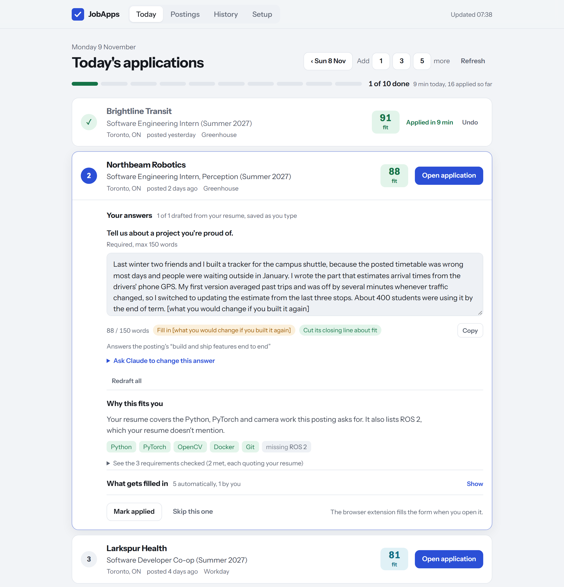

# JobApps

A self-hosted tool that picks ten internship postings a day, drafts the written answers and fills in the forms.

JobApps runs on your own PC and builds a new list every morning. You work through the list from a
dashboard in your browser, and a Chrome extension fills each application form when you open it. You
check every page and press Submit yourself. JobApps never submits anything.



The Today page, shown with made-up data.

This is a personal project built for one person's internship search. The settings in `config.yaml`
are for software and AI internships in Canada (Toronto first, Summer 2027), and the server has only
been run on Windows.

## What it does

- Collects postings every morning from six public internship lists and 136 employer job boards, and
  merges duplicates.
- Rules out postings you can't get: graduate-only roles, roles that need a citizenship or clearance
  you don't have, roles whose deadline has passed. Each rule-out shows the sentence from the posting
  that caused it.
- Scores the rest on how well your resume covers the skills they ask for. Claude then screens the
  best 25, and a requirement only counts as met if the server finds the line Claude quoted in your
  resume.
- Picks 10 new jobs a day, one per company, and skips any job it has already shown you.
- Reads the application questions ahead of time on Greenhouse, Lever and Ashby, and drafts answers
  from your resume and notes. A fact that isn't in either is flagged. Anything only you can say,
  such as why you want the job, is left as a `[placeholder]` for you to write.
- Fills forms through a Chrome extension, including Workday's multi-page applications. When it
  can't answer a question, you answer it once and it reuses the answer on later forms.
- Keeps a record of every posting and application, with how long each one took.

## Requirements

- A PC that stays on, with Python 3.11 or newer.
- [Tailscale](https://tailscale.com) on that PC and on the computer you apply from. It isn't needed
  if you only use the dashboard on the PC itself.
- Claude, through either [Claude Code](https://code.claude.com/docs/en/overview) signed in to your account or
  an `ANTHROPIC_API_KEY`. Without one, JobApps still picks jobs and fills forms, but it doesn't
  screen postings or write drafts.
- Chrome, Edge, Brave or Arc for the extension.

## Install

On the PC that will run the server, in PowerShell:

```powershell
git clone https://github.com/pyturtle/jobapps
cd jobapps
python -m venv .venv
.venv\Scripts\pip install -e .
powershell -ExecutionPolicy Bypass -File scripts\install-server.ps1
```

The last command registers a scheduled task that keeps the server running, publishes the dashboard
to your tailnet on port 8443, and prints the address to open. Without Tailscale it sets up the task
only, and the dashboard is at http://127.0.0.1:8765 on the PC. To run the server by hand instead,
use `.\ja serve`.

Then open the dashboard and go to Setup:

1. Upload your resume as a PDF. Today's list is picked again to match it.
2. Fill in the highlighted details: graduation date, citizenship, work authorization and
   sponsorship. JobApps never guesses these.
3. Check the skills it found in your resume, enter your work history, and add notes the drafts
   can draw on.
4. Download the extension, unzip it, and load the folder at `chrome://extensions` with Developer
   mode on.

## Usage

Open the dashboard each day. The Today page lists the day's jobs. Opening one shows why it fits,
the drafted answers, and what the extension will fill in. Edit the answers, press Open application,
check what the extension filled, and submit on the employer's site. The job is marked applied when
the confirmation page appears.

The other pages are Postings (everything collected and what happened to it), History (past
applications and how long each took) and Setup.

There is also a command line:

```powershell
.\ja status      # today's list and totals
.\ja explain 3   # every point and quote behind the third pick
.\ja doctor      # check your setup
```

## Documentation

- [How it works](docs/how-it-works.md): how jobs are picked, how answers are drafted and checked,
  and how form values are chosen
- [Usage](docs/usage.md): the dashboard, the extension, every command, supported sites and
  troubleshooting
- [Configuration](docs/configuration.md): `config.yaml` and your personal files
- [Privacy and security](docs/privacy-and-security.md): what is stored, what is sent to Claude, and
  who can reach the server
- [Development](docs/development.md): project layout, tests, and how to add feeds, employers and
  rules

## Limits

- JobApps never presses Submit. Read every page before you do, because sites change and a filled
  field can be wrong.
- Work authorization and sponsorship questions are filled from your profile only when they ask a
  plain yes or no about one country. Anything that asks more, and every citizenship question and
  consent box, is [left for you](docs/how-it-works.md#what-is-left-for-you). Questions are matched
  by their wording, so check these answers on every form.
- The drafts are written by a model. Facts that aren't in your resume or notes are flagged, but
  they are not removed, so read each answer and put it in your own words. Some employers don't
  accept AI-written answers.
- Questions can only be read ahead of time on Greenhouse, Lever and Ashby. On other sites the
  extension reads the form when you open it.
- Workday filling was built from saved copies of real Workday pages and tested against a mock. It
  has not been checked on many live employers, so expect to fix some fields by hand.
- It polls each list and job board once a day and only opens the postings it shortlists. Keep it
  that way, and follow each site's terms of use.

## Contributing

Bug reports and questions go in the [issue tracker](https://github.com/pyturtle/jobapps/issues),
which also lists the known bugs and planned work.

## License

[MIT](LICENSE)
