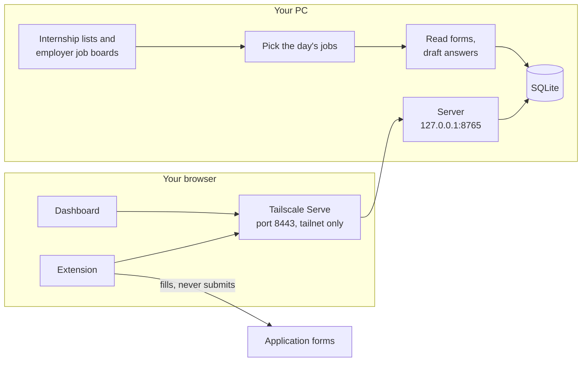

# How it works

JobApps has three parts. A server on your PC collects postings, picks the day's jobs and drafts
answers. A dashboard, served by the same process, is where you read and edit them. A Chrome
extension fills the forms on the job sites. The server decides every value; the extension only
types and clicks.

## The daily run

At `server.daily_at` (07:30 by default) the server does four things in order:

1. Fetches the public lists under `sources` and the employer boards under `boards`. The same posting
   from several sources becomes one entry. If any source fails to load, no posting is marked closed
   that day.
2. Carries over unfinished jobs from the last `carry_days` days. They are shown apart from the new
   picks.
3. Picks `daily_count` new jobs, as described below.
4. Reads each picked job's application form where it can, and drafts answers to the written
   questions.

If the PC was off at that time, the run starts when the server is next up, and it retries every hour
until the day has a list.

## Picking

Picking has four stages. Only the third uses a model.

### 1. Rank

Postings are filtered by the `filters` section of `config.yaml` (age, category, title, term, degree,
location) and scored by the `scoring` section: newer postings, forms JobApps can read ahead,
preferred locations and matching title keywords score higher. A posting that has ever been on your
list, or was ruled out before, is not considered again. Neither is the same role under a different
link: the same company and title in the same town, whatever term or year the title adds.

The top `fit.shortlist` postings (80, at most two per company) are checked live. Closed ones are
dropped. Companies in their cooldown go to the back of the queue, and postings outside Canada get
the same share of the shortlist as `max_outside_canada_per_day` gives them of the day's picks.

### 2. Read the posting and check fit

JobApps gets the posting text from the job board's API (Greenhouse, Lever, Ashby, Workday, Oracle
Cloud, Workable), from the JobPosting data many career sites embed in the page, or from the page's
own text.

When none of those works, and the Claude Code CLI is the backend, Claude searches the web for pages
that carry the same posting. JobApps then fetches those pages itself and uses their text. If no page
can be read, Claude's own summary is used instead. That case is labelled on the dashboard, and the
screen in stage 3 counts for half. Lookups are limited to `research.max_per_day` (6) and happen once
per posting.

A posting is ruled out when:

- the title is a senior, staff, lead or manager role
- it is for graduate students only
- it asks for more years of experience than `fit.max_years_required` allows
- its graduation window excludes your graduation year, or it requires returning to school after you
  graduate
- it has a GPA floor above your GPA
- it requires a citizenship, permanent residency or clearance you don't have
- it says there is no visa sponsorship and your profile says you need it in that country
- its application deadline has passed

Each rule-out is stored with the sentence from the posting that triggered it, and shown under
Postings. A rule only fires on wording it recognises. A requirement written another way is missed,
and the posting stays in. That is the intended direction: a posting ruled out by mistake is never
shown again, while one let through by mistake costs you a minute.

When a rule is changed, the postings it stopped earlier stay hidden. `ja recheck` puts back the ones
that were never on your list, are still open and pass today's filters and fit rules. The next daily
run reads and screens them like new postings, and the earlier rule-out stays in the record.

The remaining postings are scored on skills. JobApps looks for about 100 named skills (languages,
frameworks, tools) in the posting's requirements and in your resume, and awards up to
`fit.skill_points` (30) for the share you have. A deadline within a week adds points. A posting that
says it is not for an existing vacancy loses points.

### 3. Claude screen

The best `screen.top` postings (25) are sent to Claude with your resume and notes. Claude lists the
posting's requirements, marks each as required or preferred, and says whether you meet it, quoting
your resume as evidence. It also lists any eligibility rule in the posting that you fail, quoting
the sentence that states it.

The server then checks the quotes itself:

- A requirement is kept only if its text is found in the posting.
- A requirement counts as met or partly met only if the evidence quote is found in your resume or
  notes. Otherwise it is downgraded to missing.
- The fit score from 0 to 100 is computed from what is left. Required items weigh more than
  preferred ones.
- A failed eligibility rule rules the posting out only if its sentence is found in the posting and
  it is about degree level, graduation date, citizenship, work authorization or years of
  experience. Anything else Claude objects to, such as the work term or the location, is shown on
  the job as something to check and changes nothing.

A fit under `screen.min_fit` (30) rules the posting out. Scores map to the labels on the dashboard:
strong (75 and up), good (55), stretch (35) and long shot. Results are cached, so a posting is
screened once unless your resume or notes change, and `screen.top` counts only the postings that
have not been screened before.

### 4. Pick

Jobs are taken in order of total score, with these limits:

- `max_per_company` jobs per company (1)
- `max_reach_per_day` stretch roles (2)
- `max_outside_canada_per_day` jobs outside Canada (1)
- companies you have had on a list in the last `company_cooldown_days` (30) are only used when there
  are not enough others
- a posting older than `filters.stale_after_days` (21) is only picked if its screened fit is good or
  strong

`.\ja explain N` prints every point and quote behind pick N.

## How quotes are checked

The check is in `jobapps/grounding.py` and uses no model. Both texts are lower-cased and stripped of
most punctuation. A quote of 12 characters or more passes when one of these is true:

- it appears in the source as it is
- one unbroken run covering at least 90% of the quote appears in the source
- a run covering at least half of it appears, at least 80% of the quote's words are close to that
  spot, and every number in the quote is there exactly

The second and third cases exist because models often change a word or the punctuation when they
quote. This means a quote on the dashboard can differ slightly from the source. An invented number
never passes. Shorter quotes, such as "May 2028", must match exactly.

## Drafting answers

Sponsorship, work authorization and similar yes/no questions are filled from your profile, not
drafted. Drafting is for written questions.

For each job, Claude gets the posting, your resume, your notes from `background.md` and from any
file or page listed under `notes` in `config.yaml`, your `writing_preferences`, the questions with their length limits, and any answers already written for
the same application. It returns, for each question:

- the answer
- `facts_used`: the phrases from your resume and notes the answer relies on
- `posting_points`: up to three phrases from the posting the answer responds to
- a question type, such as "why this company", "project" or "behavioral"

The prompt asks for one story per answer, told plainly, and no repeated numbers or sentences across
the answers for one application. Personal reasons and lessons ("why this company matters to me",
"what I'd do differently") are used only if your notes state them. Otherwise the draft contains a
`[bracketed placeholder]` for you to replace. Answers are always in English.

The server then checks each answer:

| Check | What it looks for |
|---|---|
| Unsupported facts | a `facts_used` phrase that is not in your resume or notes |
| Unsupported numbers | a number in the answer that appears nowhere in your resume or notes |
| Unsourced company claims | a `posting_points` phrase that is not in the posting |
| Length | more words or characters than the form allows |
| Stock phrases | wording such as "passionate" or "leverage", and em dashes |
| Shape | a closing line about how well you fit, judging yourself instead of describing the work, talking about the application itself, several numbers stacked in one sentence |
| Repeats | a number or run of words already used in another answer for the same application |

A closing sentence that ties your work to the company's is cut in code. If an answer has any other
problem, Claude is asked once to rewrite it by cutting. The rewrite is kept only if it has fewer
problems than the first draft. Whatever problems remain are shown as chips under the answer on the
dashboard.

The exact prompt for each job is saved under `data/prompts/` and shown on the dashboard. Drafts
are cached, so an answer is only written again when you ask for it.

## Filling forms

The extension finds every field on the page, with its label and options, and sends the list to the
server. The server works out a value for each field from the first of these that applies:

1. The numbered block the field sits in, such as Work Experience 2 or Education 1, filled from the
   matching entry in your profile.
2. A `custom_answers` rule in your profile.
3. For work authorization and sponsorship questions: your profile, as described below. An answer
   remembered from another form is not used for these.
4. An answer you gave to the same question before (`learned_answers.yaml`).
5. One of the built-in rules in `jobapps/rules.py`, which map common questions to profile values.
6. A drafted answer, for written questions.
7. You. The field is marked in the extension's panel, and what you type is remembered for next
   time.

A value is then matched to what the field accepts. If a dropdown has no option matching your value,
the field is left for you.

### What is left for you

Some fields are never filled, because a wrong value there costs more than a blank:

- **Legal questions that ask more than yes or no about one country.** Your profile holds two facts
  per country: whether you may work there and whether you need sponsorship. A question is filled
  from them only when it asks one of those, about one country, with plain Yes and No choices.
  "Are you authorized to work in the United States without sponsorship?" asks two things, and
  "Yes, with sponsorship" says more than yes, so both are left for you. So is a question about a
  country your profile doesn't cover, or one that doesn't name a country when the job's location
  doesn't settle it.
- **Citizenship and immigration status.** There is no rule for these. An answer you give is reused
  only when the question names its country, such as "Do you require a work permit to work in
  Canada?".
- **Consent and declarations.** A box or choice that reads as "I agree", "I certify" or "I consent"
  is never ticked for you, and an optional sign-up is left alone.
- **Other people's details.** References, emergency contacts and supervisors are not filled or
  remembered.
- **Accommodation requests.**

An answer you gave one company about that company, such as "Have you worked here before?", is
offered to another company only after two companies got the same answer from you.

### Where the rules can still get it wrong

A rule matches a question by its wording, so an unusual wording can get the wrong value or the wrong
rule. Sites also change their forms. Read every page before you submit, and check the work
authorization, sponsorship and citizenship answers each time.
